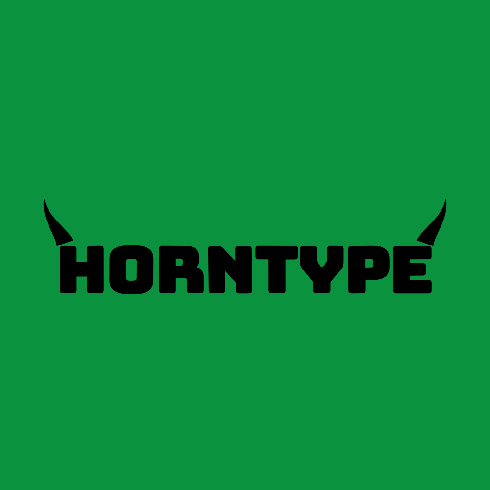

# HORNTYPE — Vector Type Instrument

一个纯前端、零构建的**艺术字体图片生成器**。输入任意英文单词、短语或多行标题，实时生成粗壮、紧凑、几何化的矢量字标，并在文字两端合成牛角状装饰。可导出透明 / 高分辨率 PNG 与可继续编辑的 SVG。



> 视觉语言来自粗野主义演唱会海报与重型展示字体：深绿背景、纯黑厚重字形、紧密字距、切角与两端弯角装饰。所有字形轮廓与装饰均为运行时生成的原创矢量路径，不复制任何现成 LOGO 或商业字体。

---

## 快速开始

项目不需要安装依赖，也不需要打包。字体通过 `fetch` 加载，因此**必须通过本地 HTTP 服务打开**，不能直接双击 `index.html`。

### Windows

双击 `start.bat`。脚本会启动本地服务并自动打开：

```text
http://127.0.0.1:4173/
```

指定其他端口：

```bat
start.bat 8080
```

### macOS / Linux

```bash
chmod +x start.sh
./start.sh
# 或指定端口
./start.sh 8080
```

### 手动启动

在 `poster_design` 目录中执行：

```bash
python -m http.server 4173 --bind 127.0.0.1
```

然后访问 <http://127.0.0.1:4173/>。

推荐使用最新版 Chrome、Edge、Firefox 或 Safari。

---

## 功能

### 1. 实时文字与排版

- 任意英文单词、短语或多行文字（最多 6 行、120 字符）。
- 输入即更新，无需点击生成。
- 大写转换、左 / 中 / 右对齐。
- 自动适配画布宽度与高度；字号可在自动适配结果的 30%–100% 之间缩放。
- 手动字间距、水平缩放、垂直缩放。
- 画布内直接拖动文字调整位置，或使用 X / Y 偏移滑杆。

### 2. 四种字体预设

| 预设 | 字体骨架 | 特征 |
|---|---|---|
| **CHUNKY** | Bungee | 最厚重、最紧凑，接近参考图的块状字标 |
| **GEOMETRIC** | Archivo Black | 更规整、几何化，强调字母结构 |
| **DISTORTED** | Anton | 更窄的字形骨架，叠加切角、波动与不规则变形 |
| **POSTER** | Bowlby One SC | 超粗、小字怀、圆角，最接近原海报的 Poleno 气质 |

字体不是直接以 `<text>` 渲染，而是由 opentype.js 在浏览器中解析 TTF，将每个字母转换为 SVG 轮廓路径，再进行加粗、圆角、变形和切角处理。

> Poleno 是原海报使用的商业字体，本项目不包含、也不下载该字体。**POSTER** 使用的是可自由分发的开源近似字体 Bowlby One SC。

### 3. 字形参数

- **字号**：自动适配结果的缩放比例。
- **字重**：通过同色描边扩张轮廓，形成更厚的字面。
- **字间距**：负值更紧凑，正值更疏朗。
- **水平 / 垂直缩放**：独立的 X / Y 比例。
- **圆角程度**：控制转角是圆润还是硬朗。
- **变形程度**：控制每个字母的旋转、倾斜、波动与切角缺口。

所有参数变化都会立即反映到预览。

### 4. 牛角装饰

装饰是独立的 SVG 填充路径。渲染时先绘制装饰层，再把文字层叠在上面，让装饰根部自然收进字母轮廓后面，而不是在文字旁边贴图标。

- 可开启 / 关闭。
- 左侧、右侧或两侧。
- 三种形态：**BULL**（实心弯角）、**HOOK**（尖端下折）、**BLADE**（多面切角）。
- 尺寸、角度、弯曲程度、水平偏移、垂直偏移均可独立调节。
- 自动适配会为装饰预留宽度与高度，避免被画布裁切。

### 5. 颜色与背景

- 文字色、背景色、装饰色独立选择。
- 每个颜色同时支持系统色盘和 **HEX 输入**（`#0A923E` / `0A923E` 均可）。
- 12 组内置配色，默认 **CHROMA**：深绿 `#0A923E` 背景 + 纯黑文字 / 装饰，接近原海报。
- 一键交换文字色与背景色。
- 背景透明度 0–100%。
- 透明背景开关；透明时预览区显示棋盘格。

### 6. 画布与构图

- 1:1（1600 × 1600）。
- 16:9（1600 × 900）。
- 3:2（1600 × 1067）。
- 自定义宽高（600–2400 px）。

**WORDMARK**：文字本身作为主体，适合 LOGO、标题、品牌字样。

**POSTER**：在文字上下加入副标题与署名，形成主标题 / 副标题 / 署名的三层海报结构；副标题字号、署名字号、层级间距可调。

### 7. 导出

点击顶部 **导出 PNG** 或 **SVG**，在对话框中选择格式与倍率。

**PNG**

- 1×、2×、3×、4× 或自定义倍率（1–4，步进 0.5）。
- 支持透明背景。
- 自动限制最大边 12,000 px、最大面积 80,000,000 px，避免浏览器内存崩溃；若触发限制会在对话框中提示实际输出尺寸。
- 文件名包含文字 slug、尺寸与 `transparent` 标记。

**SVG**

- 保留矢量路径，可直接在 Illustrator、Figma 等软件中继续编辑。
- 不包含 `<text>`、外部字体引用或滤镜；文字已全部转为轮廓。
- 背景为独立矩形图层；透明背景时不含背景矩形。

预览与导出共用 `Engine.build(state)` 这一条构建管线，几何、颜色、装饰位置一致。

---

## 项目结构

```text
poster_design/
├─ index.html              # 页面结构
├─ css/
│  └─ styles.css           # 深色编辑面板 + 明亮预览区、响应式布局
├─ js/
│  ├─ engine.js            # 字体解析、轮廓生成、变形、装饰、构图、SVG 构建
│  └─ app.js               # 状态、控件绑定、拖拽、缩放、导出
├─ fonts/
│  ├─ Bungee-Regular.ttf
│  ├─ ArchivoBlack-Regular.ttf
│  ├─ Anton-Regular.ttf
│  ├─ BowlbyOneSC-Regular.ttf
│  ├─ SpaceMono-Regular.ttf
│  └─ OFL-*.txt            # 各字体 SIL Open Font License
├─ vendor/
│  ├─ opentype.min.js      # opentype.js 1.3.4
│  └─ OPENTYPE-LICENSE.txt # MIT
├─ preview.png
├─ start.bat
├─ start.sh
└─ README.md
```

---

## 技术说明

- **SVG 优先**：文字、装饰、背景为独立 SVG 图层；文字全部转为路径。
- **实时预览**：参数变化后通过 `requestAnimationFrame` 合并重绘。
- **同一构建源**：预览与 PNG / SVG 导出都调用 `Engine.build(state)`；PNG 只是把同一份 SVG 结果光栅化。
- **无 AI 图像模型**：文字准确性、字重、字距和装饰位置完全由参数与矢量路径控制。
- **零运行时依赖**：opentype.js 已本地打包；不需要 npm install，不需要网络。
- **自动保存**：参数保存在 `localStorage` 的 `horntype.state.v2`；重置会恢复默认值。

### 已知限制

- 内置展示字体只覆盖拉丁字符。输入中文、日文、韩文等字体中不存在的字符时，这些字符会被跳过，并在文本框下方显示 `NO GLYPH` 警告；建议使用英文。
- 超过 6 行会截断并显示 `MAX 6 LINES`。
- 极端参数组合（极大的字重 + 很大的变形 + 很长的文本）仍会自动适配，但视觉上可能更拥挤；可降低字号或字重。
- 直接以 `file://` 打开时，浏览器会阻止字体 `fetch`，页面无法完成初始化；必须使用本地 HTTP 服务。

---

## 字体与许可

本项目打包的字体均为 SIL Open Font License 1.1，可随项目分发：

- **Bungee** — David Jonathan Ross / DJR
- **Archivo Black** — Omnibus-Type
- **Anton** — Vernon Adams
- **Bowlby One SC** — The Bowlby One Project Authors
- **Space Mono** — Colophon Foundry

完整许可文本位于 `fonts/OFL-*.txt`。

**opentype.js** 以 MIT License 分发，许可文本位于 `vendor/OPENTYPE-LICENSE.txt`。

本项目为非商业粉丝向实验工具，与 Tyler, The Creator 及其团队无关联。视觉语言受 CHROMAKOPIA 海报启发，但不包含原海报图片、原版 Poleno 字体或原 LOGO 的描摹；请勿将本项目生成的视觉资产直接作为他人商标使用。
